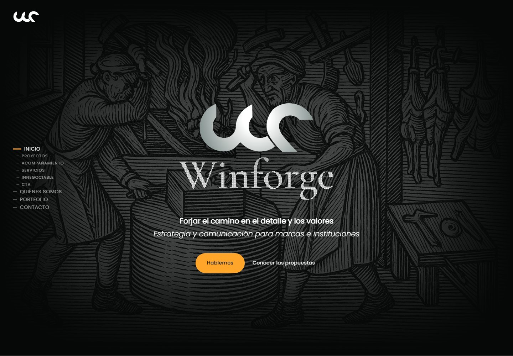
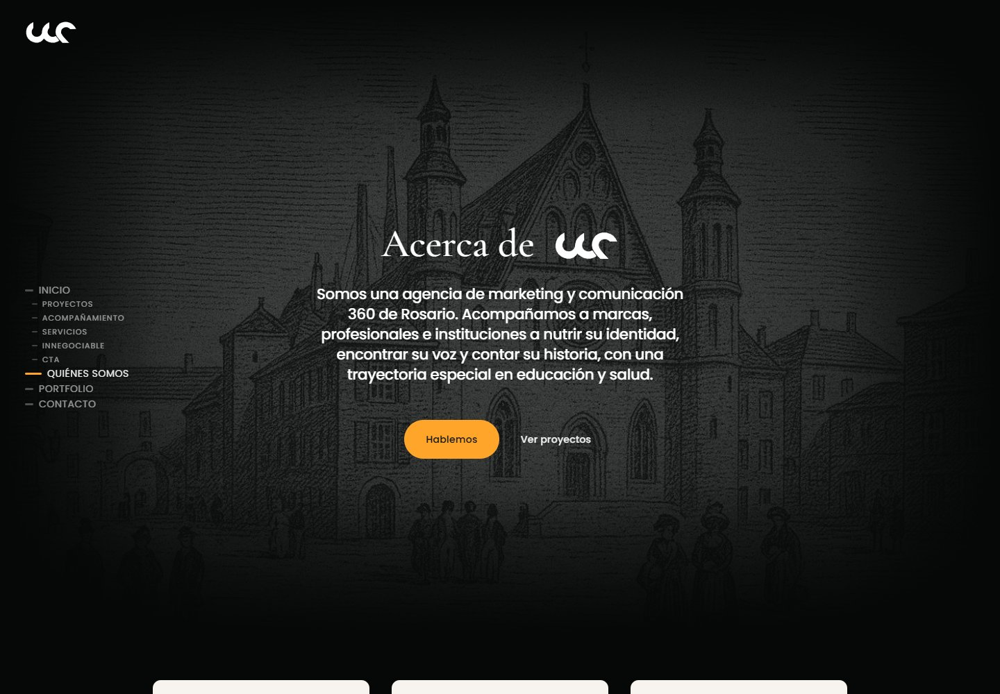
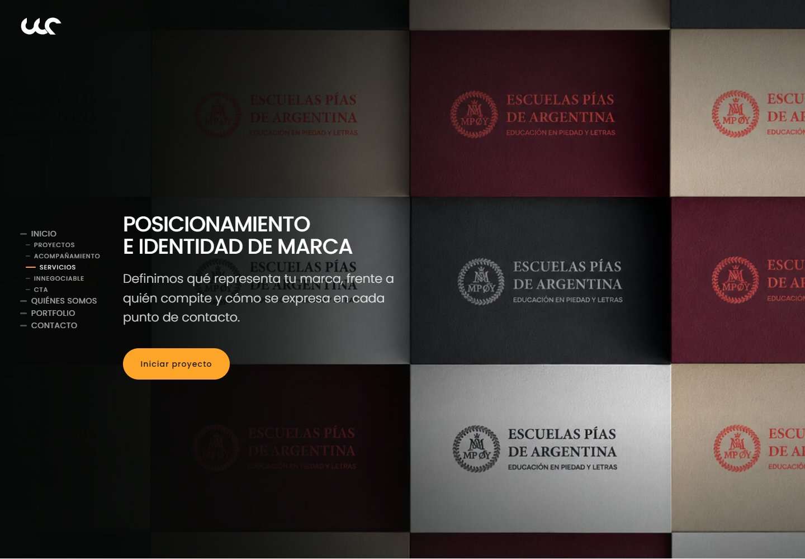
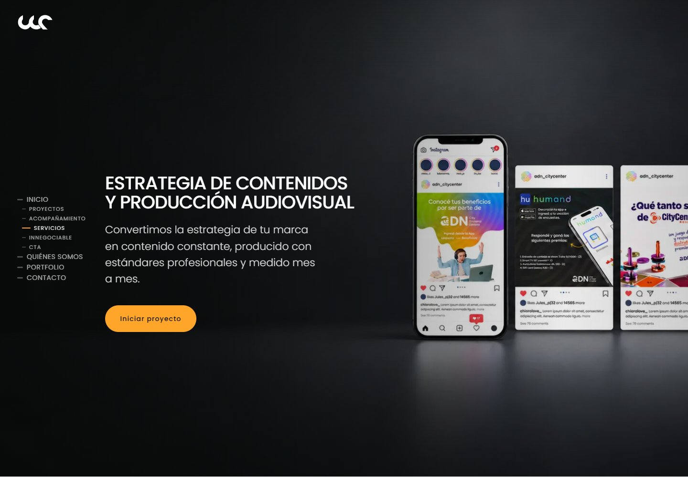
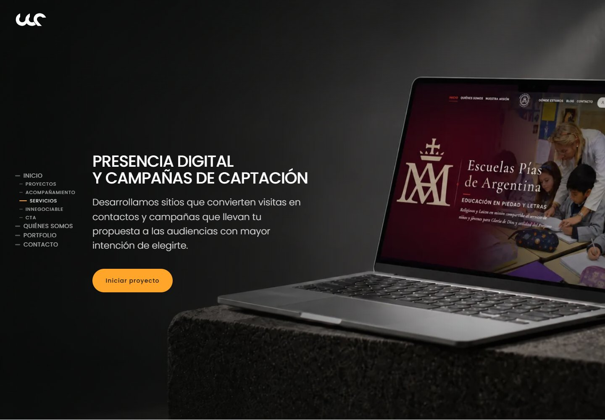
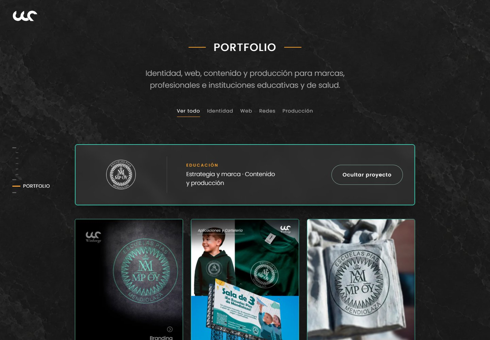
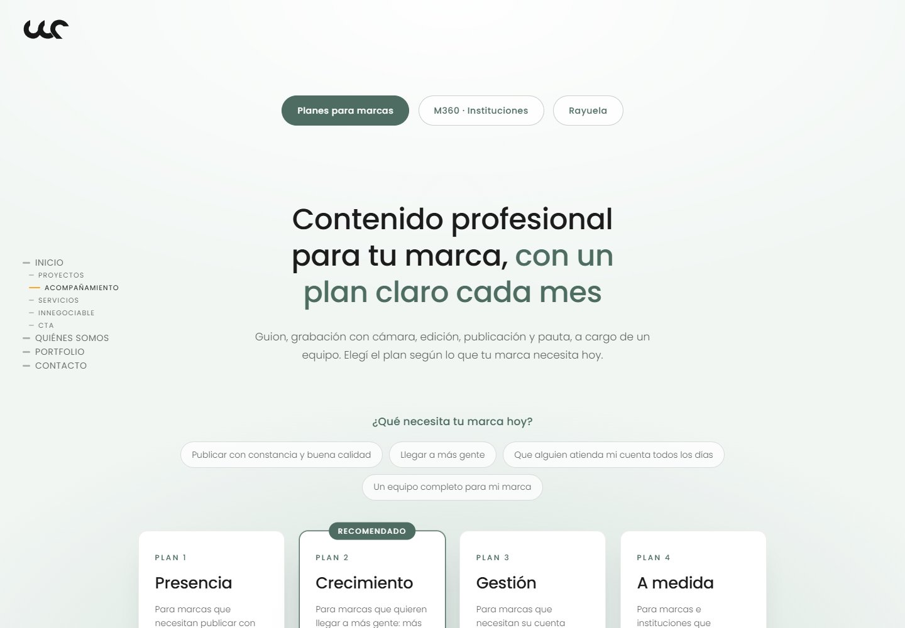
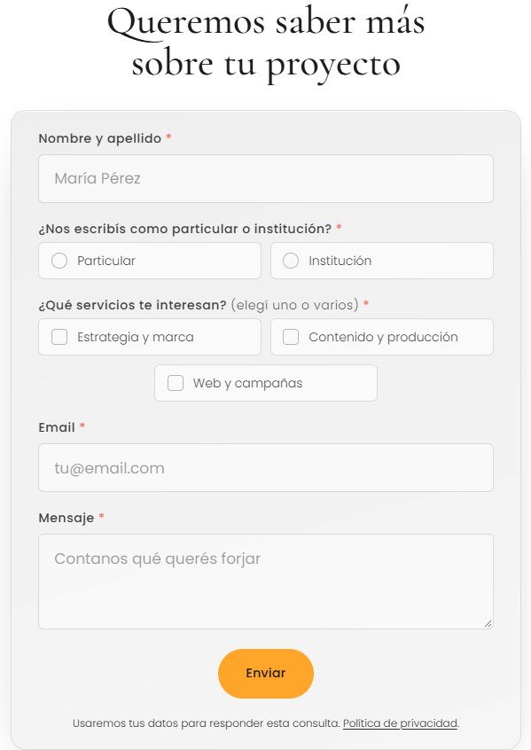

# Winforge

**Estrategia y comunicación para marcas e instituciones.**

Este repositorio reúne la nueva web de Winforge, una agencia de marketing y comunicación 360 de Rosario. El sitio presenta al equipo, muestra proyectos y acerca sus servicios a marcas, profesionales e instituciones.
La idea es que quien llegue pueda conocer cómo trabaja la agencia, recorrer ejemplos y encontrar una propuesta que tenga sentido para su proyecto. Desde una identidad de marca hasta una campaña, un sitio web o la comunicación de un colegio, cada recorrido tiene un espacio propio y una forma de iniciar la conversación.

## Un recorrido por la web

El sitio está organizado en **nueve páginas**. Las tres áreas de servicios tienen su propia presentación, ejemplos y acceso al contacto.

| Página | Qué vas a encontrar |
| --- | --- |
| [Inicio](index.html) | La presentación de Winforge, proyectos destacados, las áreas de trabajo y una primera mirada a sus propuestas. |
| [Quiénes somos](quienes-somos/index.html) | La presentación de la agencia, sus pilares, misión, visión y equipo. |
| [Estrategia y marca](servicios/estrategia-y-marca/index.html) | Diagnóstico, posicionamiento, identidad visual, nombres, tono de voz y comunicación institucional. |
| [Contenido y producción](servicios/contenido-y-produccion/index.html) | Planificación de contenidos, gestión de redes, producción audiovisual y edición. |
| [Web y campañas](servicios/web-y-campanas/index.html) | Sitios web, campañas en Meta y Google, visibilidad en buscadores y newsletters. |
| [Portfolio](portfolio/index.html) | Una selección de proyectos, con filtros para explorar identidad, web, redes y producción. |
| [Propuestas](propuestas/index.html) | Planes para marcas, M360 para instituciones educativas y la presentación de Rayuela. |
| [Contacto](contacto/index.html) | Un formulario para contar una idea, indicar los servicios de interés y consultar al equipo. |
| [Política de privacidad](politica-de-privacidad/index.html) | Información sobre los datos que se solicitan, para qué se usan y cómo ejercer los derechos sobre ellos. |

Los enlaces de esta tabla abren los archivos del proyecto dentro del repositorio. Las capturas permiten ver su presentación en el navegador.

## La identidad de Winforge

La idea de **forjar** atraviesa el diseño y el relato del sitio: trabajar los detalles, dar forma a una idea y sostener un proceso. Aparece en las imágenes, las texturas, las piezas de arte y la manera de presentar los proyectos.

La web combina fondos claros y oscuros, verdes suaves y acentos naranjas. Las tipografías grandes, los espacios amplios y las animaciones acompañan ese lenguaje visual. El recorrido alterna presentaciones, ejemplos y llamadas a conversar con la agencia.

En **Quiénes somos**, esa mirada se expresa a través de tres pilares: **orden, proceso y repetición**. También hay un espacio para conocer a las personas que forman parte del equipo.

## Tres áreas de trabajo

### Estrategia y marca

Es el espacio dedicado a pensar qué representa una marca, qué quiere contar y cómo se reconoce. Reúne el diagnóstico, el posicionamiento, la identidad visual y verbal, y la comunicación de instituciones.

### Contenido y producción

Presenta el trabajo que hay detrás de las publicaciones: planificación, gestión de redes, guion, rodaje y edición. La página conecta esos servicios con proyectos relacionados para mostrar cómo se llevan a la práctica.

### Web y campañas

Reúne las herramientas digitales que ayudan a una marca a ser encontrada y recibir consultas: desarrollo de sitios, publicidad, presencia en buscadores y comunicación por correo. Cada servicio puede recorrerse dentro de la misma página.

## Los proyectos

El portfolio permite mirar el trabajo desde distintos ángulos. Se puede recorrer todo o filtrar por **identidad, web, redes y producción**, y abrir cada proyecto para ver sus piezas.

Incluye trabajos para organizaciones y marcas como Escuelas Pías, Box House, Franco Della Vedova, COE, Oxyferrum y XOP ERP. La galería da lugar a las imágenes para que cada identidad y cada aplicación puedan apreciarse con detalle.

## Propuestas para distintas necesidades

La página de propuestas tiene tres recorridos que se pueden cambiar desde un selector:

- **Marcas:** planes de contenido llamados Presencia, Crecimiento, Gestión y A medida. Permiten comparar alcances y consultar por el que mejor se ajuste al proyecto.
- **M360 · Instituciones:** propuestas para colegios de gestión privada, con foco en la comunicación con su comunidad y el trabajo de admisión.
- **Rayuela:** presentación de una herramienta para acompañar las consultas de las familias y el proceso hacia la entrevista, con información sobre sus funciones y tramos según la cantidad de alumnos.

Cada recorrido muestra sus condiciones y termina con un formulario específico. La web presenta Rayuela y permite consultar por ella; su plataforma de gestión no forma parte de este repositorio.

## De una visita a una conversación

Los formularios son parte del recorrido de la web. La intención es que una persona pueda explicar qué necesita sin tener que armar un mensaje desde cero.

En **Contacto** se puede completar el nombre, indicar si se escribe como particular o institución, elegir uno o varios servicios, dejar un correo y escribir el mensaje.

Hay **cuatro formularios** en total:

| Formulario | Para qué sirve |
| --- | --- |
| Contacto general | Contar un proyecto y seleccionar los servicios de interés. |
| Planes para marcas | Consultar por un plan de contenido. |
| M360 | Presentar una institución, el cargo de quien consulta y el nivel de servicio que le interesa. |
| Rayuela | Consultar por la herramienta e indicar la institución, el cargo y la cantidad de alumnos. |

Los campos muestran avisos cuando falta información o hay algo que corregir. Durante el envío se indica que la consulta está en proceso; si ocurre un problema, se conserva lo escrito para poder volver a intentarlo.

Las consultas se envían por correo al equipo. El asunto incluye el tipo de consulta y el nombre de la persona, por ejemplo: **«[Winforge] Consulta de contacto — Ana Pérez»**. Al responder, el destinatario es el correo que dejó esa persona en el formulario.

## También desde el celular

La distribución se adapta a pantallas pequeñas: el menú se despliega, las secciones se reorganizan y los formularios se pueden completar desde el teléfono. El sitio también contempla la preferencia de reducir movimiento del dispositivo.

## Sobre este repositorio

Acá están las páginas, sus estilos, las imágenes y el código que hace funcionar las interacciones y los formularios. La web está hecha con **HTML, CSS y JavaScript**, y utiliza **PHP** para enviar las consultas por correo.

Las capturas de este README corresponden a la versión local del proyecto y están guardadas en [`docs/imagenes`](docs/imagenes). Muestran el diseño sin datos personales de consultas reales.

